# Dashboard

A phone-first web dashboard at `/dashboard`, rendered by the api process with Jinja2 and HTMX.
It is for setup, looking things over and fixing mistakes; daily use happens in chat.

  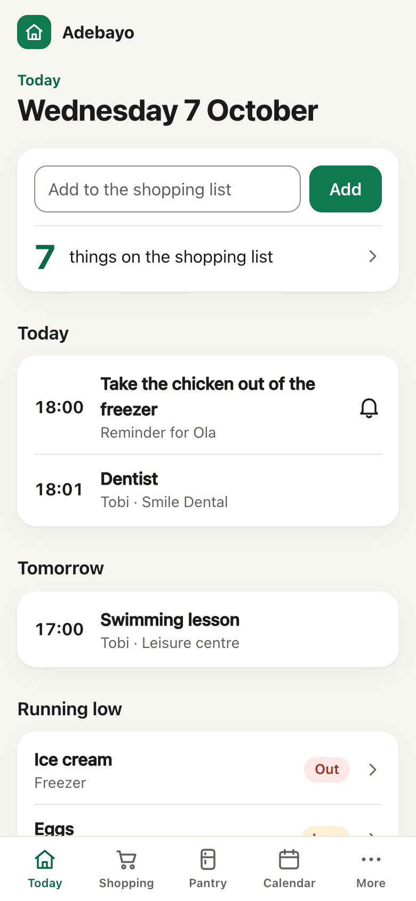
  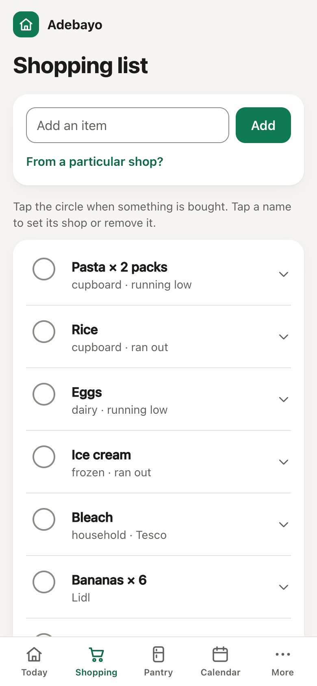
  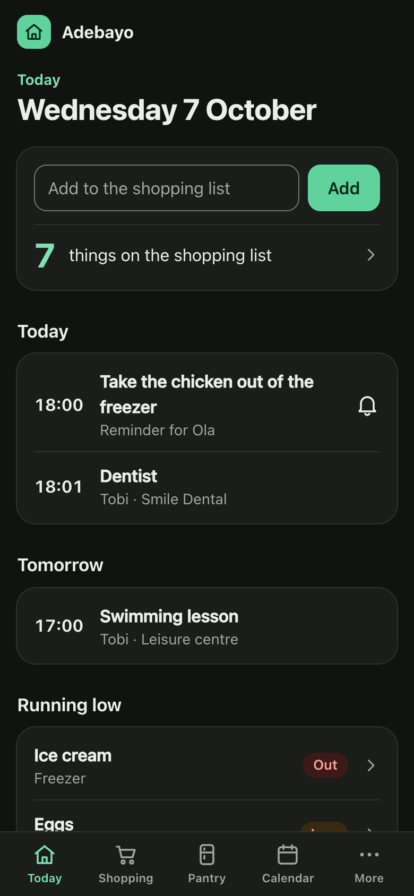

## How it looks

A phone has four tabs along the bottom, Today, Shopping, Pantry and Calendar, and a fifth, More,
that opens a page listing the rest: Spending, Jobs, Family, Chat apps, Settings, Activity, Practice chat, System
(admins only) and Log out. From 960 px wide the tabs become a sidebar that shows every page, so
More is not needed there.

  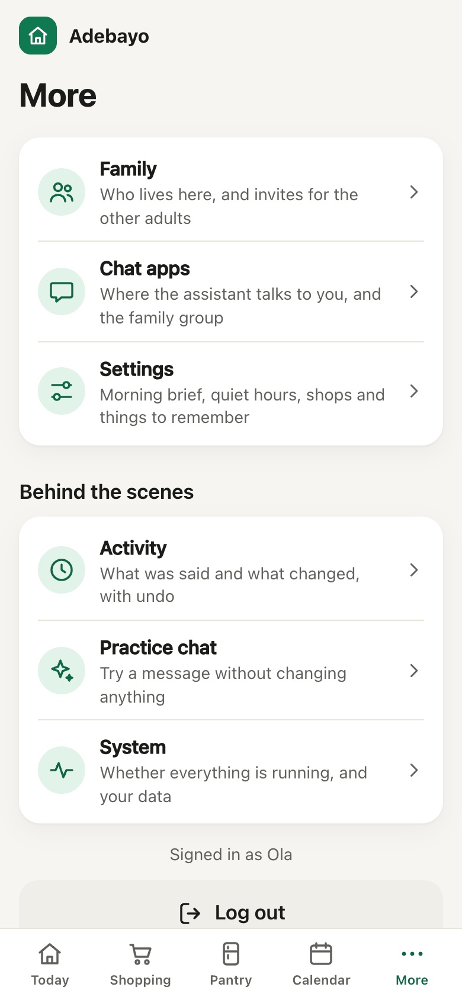
  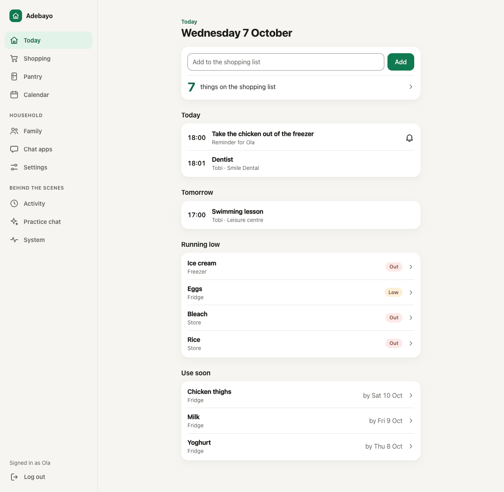

Each screen has one main thing to do, and a list reads as a list: what a row can change (its shop,
its time, its quiet hours) opens when the row is tapped. Pages say things in the family's words,
not the database's: "Running low", "every week on Tue, Thu", "Not delivered". The words are in
`app/dashboard/words.py`. Light and dark follow the system setting.

Three pages are named differently here than in the code and in the other documents, and their
paths have not changed: **Pantry** is the inventory (`/dashboard/inventory`), **Chat apps** is the
channels page (`/dashboard/channels`) and **Practice chat** is the Playground
(`/dashboard/playground`).

There is still no build step ([ADR 0005](adr/0005-htmx-dashboard-instead-of-spa.md)): one
hand-written stylesheet, `static/app.css`; icons drawn as inline SVG; and `static/app.js`, about
forty lines that pick the device's time zone on `/setup`, copy a link or code when Copy is pressed,
and say so when a request fails. Every page works without that script. Colours meet WCAG AA
contrast in both modes, every control is at least 44 px tall, and focus is always visible.

## First run

Open `/setup?token=<SETUP_TOKEN>` while no household exists. Step one asks for a first name and a
name for the household. The time zone is a list with `DEFAULT_TIMEZONE` chosen, which the page
replaces with the device's own zone where the browser gives one. Submitting creates the household
with locations `fridge`, `freezer` and `store`.

Step two is the admin's invite, shown once: a button that opens Telegram with the code already in
it, a QR code of the same link for another phone, and the code itself to send by hand. After that
`/setup` returns 404.

  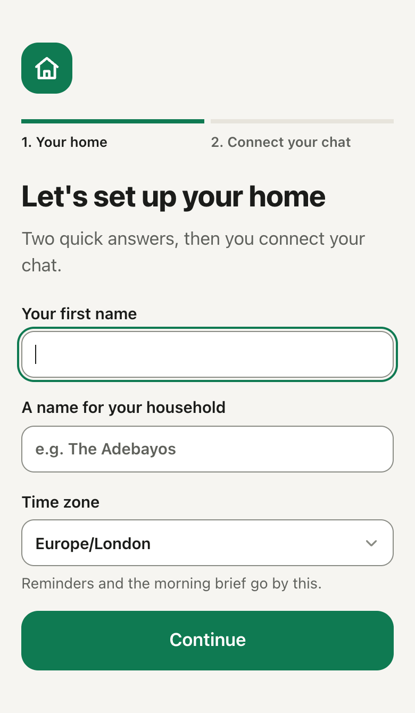
  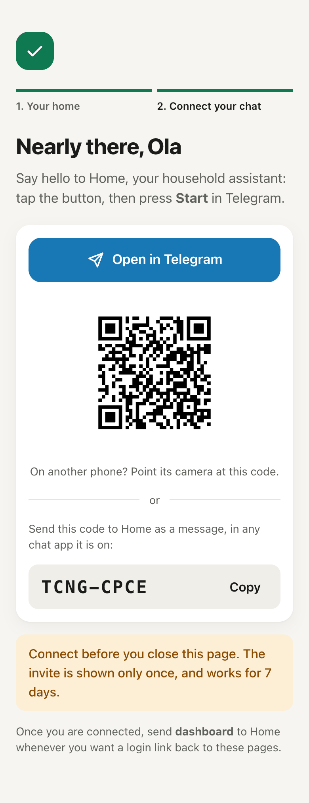

## Login

No passwords. A connected adult sends `dashboard` to the bot. The pipeline answers that exact
keyword itself (no model call) with a DM containing `/login/{token}`: 32 random bytes, stored
hashed, valid 10 minutes, single use, 5 per member per hour. Children never get logins.

Opening the link (`GET`) shows a page with one button, **Open my dashboard**, and changes nothing.
The button is a `POST` to the same address. That is what spends the token and sets a signed,
HttpOnly, SameSite=Lax cookie for 30 days (Secure when `PUBLIC_BASE_URL` is https) carrying the
member id and `members.session_version`. `POST /logout?everywhere=1` bumps that version and ends
every session. A chat app opens a link it is sent, to show a preview, before the person can tap
it; when the `GET` spent the token, the person's own tap found it used
([ADR 0035](adr/0035-a-login-link-is-spent-by-its-button.md)).

Anyone without a session gets a page that lists those steps and, when `TG_BOT_USERNAME` is set, a
button that opens the chat in Telegram. Someone who opens a link that was used or is more than 10
minutes old gets the same page under the words "This link no longer works. It was already used or
has expired. Send the word dashboard to Home for a fresh one."

  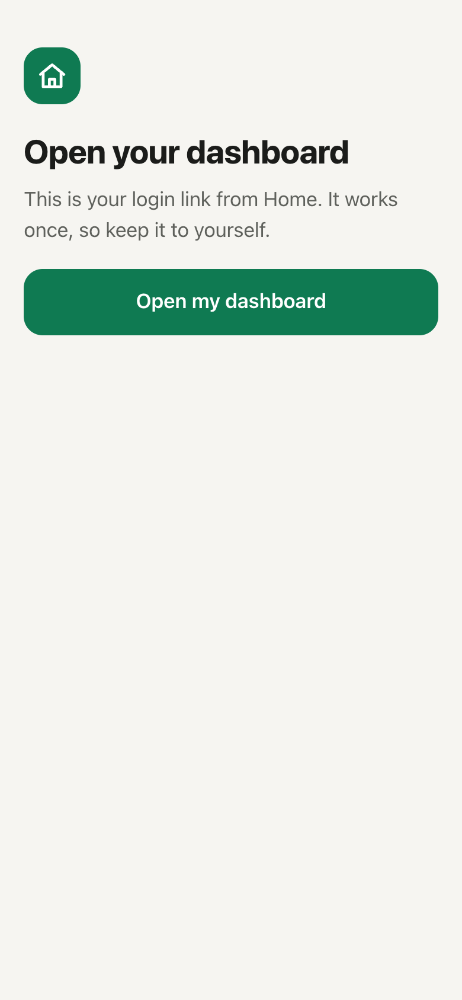
  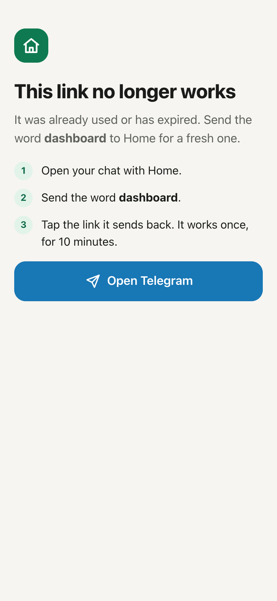
  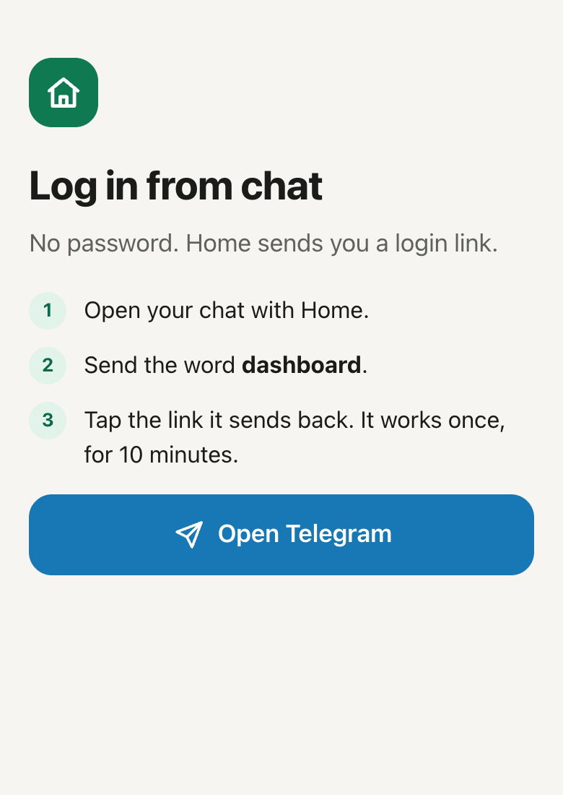

Every POST carries a CSRF token derived from `SESSION_SECRET` and the session, in the
`X-CSRF-Token` header (set once on `<body>` via `hx-headers`) or a `csrf` form field. A mismatch
returns 403. The one POST without it is the login button, which has no session yet: the address
itself is the secret, and a request that a browser marks as coming from another site is refused.

## Pages

| Page | Path | Shows | Actions |
| --- | --- | --- | --- |
| Today | `/dashboard` | Shopping list count, today's and tomorrow's events and reminders, the household jobs that are waiting or due by tomorrow, what is running low or has run out, what goes out of date within 3 days, and a line saying how to ask the assistant what to cook | Quick-add to the list, tick a job off |
| Shopping list | `/dashboard/shopping` | Active list, then "You might also need" | Add, tick off with the circle, remove, set the shop |
| Pantry | `/dashboard/inventory` | Stock by location, filter by status; per-item history | Set a count, mark none left, edit an item (other names, always kept in, low threshold, usual place), merge a duplicate |
| Calendar | `/dashboard/calendar` | The next 30 days with repeats expanded, the repeating series, standalone reminders, the viewer's own connected Google or Apple Calendar and who else has one | Add an event (once, daily, weekly or monthly), edit title, time and place, cancel, skip one date of a series, cancel a reminder, connect or disconnect a Google or an Apple Calendar, get the calendar link |
| More | `/dashboard/more` | The pages below, each with a line about what it is for | Log out |
| Spending | `/dashboard/spending` | One month, from the receipts that were sent: the total, by shop, by kind of thing with what the lines do not account for, the last six months, price changes on staples, and each receipt. `?month=2026-09` shows another month | Correct a receipt's shop, day, total or a line's price, clear a line's price, take a receipt out |
| Jobs | `/dashboard/jobs` | Household jobs, renewals and birthdays: the ones asked about and not done yet, then what is coming up, each with whose it is, when it is due and how often it comes round | Tick a job off with the circle (the next one is then set), skip one, stop one |
| Family | `/dashboard/family` | Everyone in the household, each adult's connected chat apps, open invites | Add an adult or a child, make a new invite (button, QR code and code, shown once), cancel an invite, choose which connected chat app an adult is messaged on |
| Chat apps | `/dashboard/channels` | Each channel: whether it is set up, when it last heard from and sent to the family, sends failed in the last day, and for iMessage since when it has been unreachable. Each chat: whose it is, the main family chat, and for WhatsApp whether any message or only the standard reminder will be delivered | Create a WhatsApp group, forget one that was never confirmed, show a group's invite link and QR code, choose the main family chat |
| Activity | `/dashboard/activity` | The last 200 turns and dashboard actions as a conversation: what was said, the reply and whether it was delivered, and what changed, each line with a tick, or with a warning mark where something was not recorded (an item whose name was unclear, a date in a letter that was held back to ask about). An admin also gets "Technical details" on each: tool calls and results, tokens, latency, the error of a failed turn | Undo a change, send a failed reply again |
| Practice chat | `/dashboard/playground` | A chat with the agent in the browser | A practice run by default; tick "Save it for real" to keep the result |
| Settings | `/dashboard/settings` | The morning brief time, the currency, each adult's quiet hours, whether each adult has a link for arriving at a shop, places and their kinds, things to remember | Change the brief time, choose the currency, change or clear quiet hours, make or replace a link, add a place or change its kind, add, change or forget a fact |
| System (admin only) | `/dashboard/system` | Whether the worker is alive, the newest runs of the once-a-day jobs, the runtime, provider and model, the last eval result, whether stock matches the event log, the version and migration | Rebuild stock from the event log, download everything as JSON |

  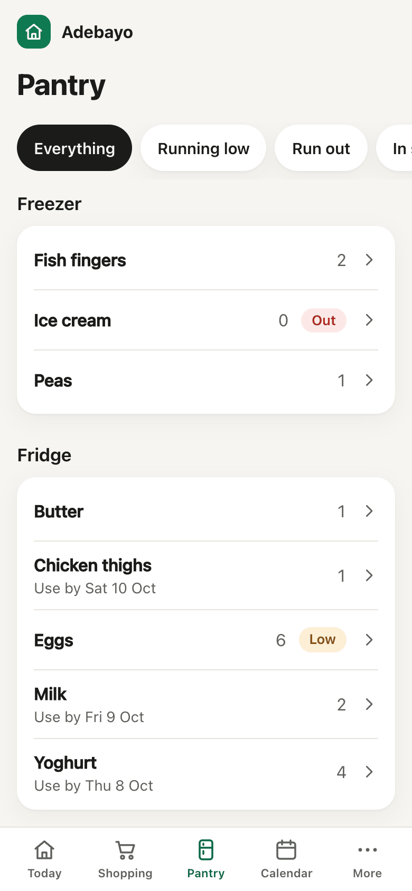
  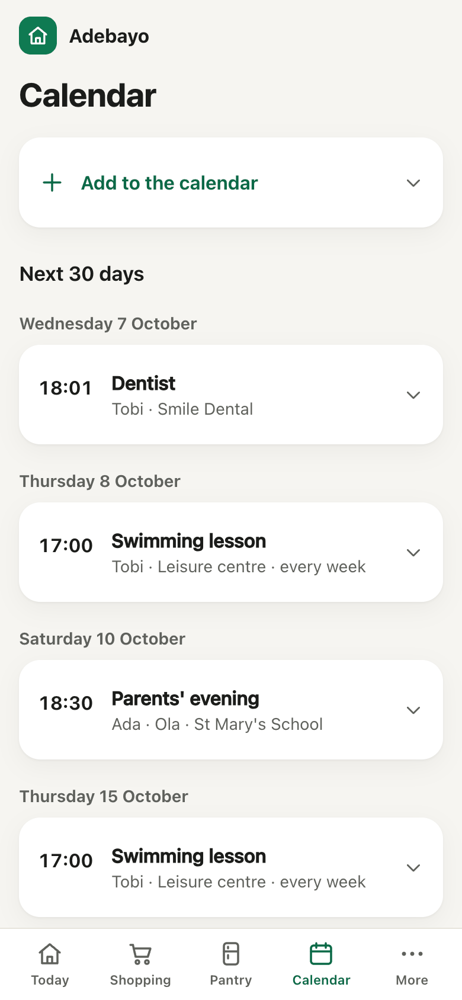
  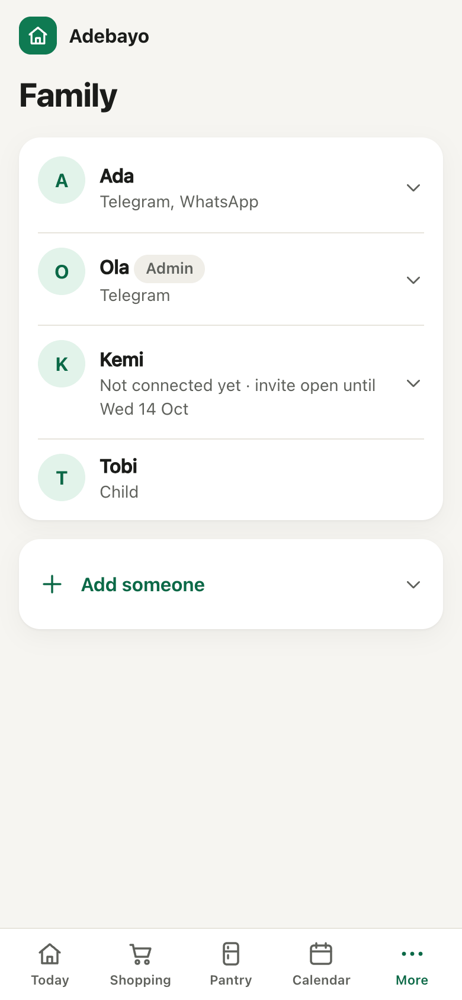

  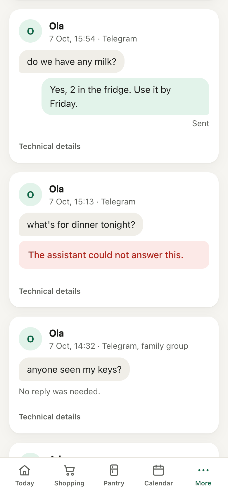
  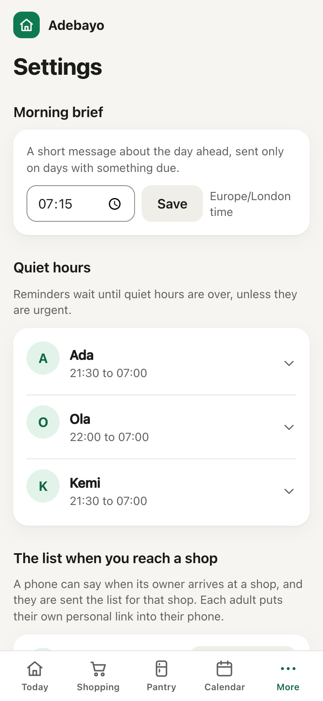
  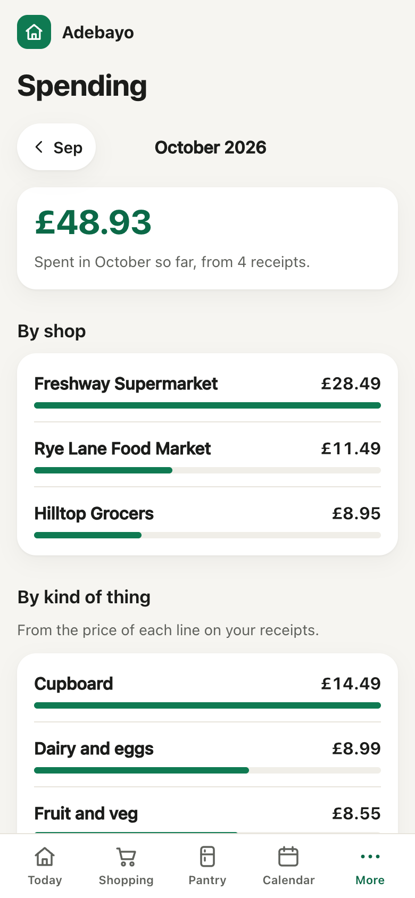

  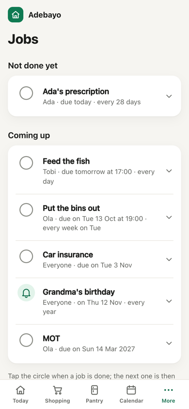

Reminders are added in chat; the Calendar page lists
and cancels them. Jobs are added and changed in chat too ("the bins go out every Tuesday night,
Ola does them", "Ada does the bins now"); the Jobs page ticks them off, skips one and stops them
([agent-and-tools.md](agent-and-tools.md#household-jobs)). A date such as a birthday has no
circle: there is nothing to tick off. In the code and the address the page is `jobs`, and so is
`app/services/jobs.py`; the worker's own scheduled jobs are `app/worker/jobs.py`. "Always keep this in" (a staple) is set on an item's page. The calendar link
stays on the Calendar page.

## Spending

Everything on the page is added up from receipts the assistant read
([ADR 0040](adr/0040-spending-is-kept-from-receipts-beside-the-stock-log.md)); nothing is typed in.

- **The month.** One figure, "Spent in October so far, from 4 receipts". A month whose receipts
  were read before prices were kept says "its prices were not kept, so what was spent is not
  known" and shows no figure; a month with both says how many more receipts had no prices.
- **By shop** and **By kind of thing**, each row with a bar for its share of the largest. Kinds
  are the supermarket sections items are sorted into overnight; a line not sorted yet is "Not
  sorted yet". Under them, where they apply: "Not listed line by line" (paid, going by the totals,
  with no price read for the line) and "Discounts".
- **Month by month.** The six months up to the one shown: an amount and a bar, "Prices not kept",
  or "No receipts". Each is a link to that month.
- **Price changes** on things the household always keeps in, against the last time they were
  bought at the same shop.
- **Receipts.** Tapping one opens what was read: the shop, the day, the total paid and each line's
  price, with Save, and "Take this receipt out". An empty total means none was printed, and the
  receipt then counts for its lines; an empty price drops that line's price. Taking a receipt out
  changes the spending only, never the pantry. Each is logged in Activity and can be undone there.

The currency is on Settings. Amounts already kept stay in the currency they were read in.

## Presence links and places

"The list when you reach a shop" on Settings lists each adult with "has a link" or "no link yet",
or "has a link made for an old web address: it no longer works" when the link was made before
`PUBLIC_BASE_URL` changed, and "perhaps made for an old web address" when that is not known
([ADR 0042](adr/0042-a-shop-link-is-replaced-by-asking-and-follows-the-address.md)).
"Make link" or "Replace link" creates a new personal link and shows it once, to be sent to that
person; only its hash is stored, so it cannot be shown again, and replacing it stops the old link
working. Any adult can make a link for any adult, as with invites. Anyone can also get a link, or
a new one, by sending the word `shops` in chat. The steps for the phone are not on Settings: they
are on the page the link opens ([presence.md](presence.md#setting-it-up-one-shop-at-a-time)).

"Places" lists what the assistant knows by name: the shops said during setup, anything added
here, and any name a phone has sent. Only a place of kind `store` sends its list on arrival, and
only `home` counts for "out and about", so a place that appeared as `other` needs its kind set
here. Changing a kind is logged in Activity and can be undone; making a link is logged and cannot.

## Inviting the family

Adding an adult on the Family page creates the member and shows their invite once: a Telegram deep
link behind "Open in Telegram", a QR code of it, and the code itself, which can be sent to the bot
on any connected channel. It is the same invite the setup page ends on. Only the code's hash is
stored. It works once per channel and for 7 days; "New invite" replaces it and "Cancel the invite"
ends it. Both are behind the person's row, which opens when tapped. The same happens from chat:
tell the assistant another adult lives there and it sends you the invite to pass on. When they open
it their chat is linked, it becomes their preferred channel, and they can send `dashboard` to log
in themselves. Children are records only: no chat, no login, no quiet hours.

Quiet hours are on Settings rather than Family, next to the brief time they belong with. A fact
named `shops` or `main_supermarket` also becomes a shop in `places`. The keys `staples`,
`morning_brief` and `quiet_hours` are settings, not facts, and are refused in the facts form
([ADR 0016](adr/0016-settings-said-in-chat-go-through-remember.md)).

## Chat apps and the family group

What is addressed to the whole household (the morning brief, a reminder for a child's activity)
goes to the main family chat: the first group a connected member writes in, or the one chosen with
"Make main chat". With no group, each adult gets it by DM.

"Create group" asks WhatsApp for a group with the given name. WhatsApp creates it a moment later
and tells the api by webhook; until then the page shows it as "being created", and once it exists
it is the main family chat. If the confirmation never comes, "Forget" drops the request so it can
be made again. "Invite link" then asks WhatsApp for the group's link and shows it
with a QR code. The link is fetched each time and never stored. Each adult opens it to join, since
WhatsApp does not let a business add people to a group. Anyone holding the link can join, so pass
it on privately ([ADR 0021](adr/0021-whatsapp-groups-are-created-asynchronously.md)).

To use a group that already exists on Telegram, add the bot to it and write something there.

Moving someone's DMs to another channel is on the Family page: tap a person with more than one
connected chat app, choose under "Message Ada on" (their name) and save. Nothing else needs
changing.

## System

Only a member with `is_admin` (whoever ran `/setup`) gets the System link, in the sidebar and on
More, and the page, the export and the rebuild answer 403 to anyone else. This page keeps the
system's own words (`job_runs`, the provider's name, the event log): it is for whoever looks after
the installation.

- **Worker.** The worker writes a heartbeat every minute. The page says "Running" with the time
  of the last one, or that the worker is probably not running once the last is more than three
  minutes old. Nothing is answered, sent or reminded while the worker is down.
- **Job runs.** The 30 newest runs of the jobs that happen once a day or week (`daily_brief`,
  `weekly_digest`, `consumption_model`, `low_stock_prompt`, and `monthly_spending` for a month
  whose spending went out with a digest), from `job_runs`. Messages, sends and
  reminders are handled continuously and leave no row; they show on Activity.
- **Model.** `AGENT_RUNTIME`, `LLM_PROVIDER`, the endpoint's host (or that the provider is a CLI
  on a subscription sign-in), `LLM_MODEL`, `LLM_FAST_MODEL` when set, and whether photos are
  read. Never a key. When the household's newest handled message failed, its error is shown
  first: with a subscription provider that is where an expired sign-in or a used-up allowance
  appears. It goes once a later message is answered.
- **Last eval result.** For each provider, what the eval suite last wrote into
  `EVAL_RESULTS_DIR` (default `tests/evals/.results`): passed of total, the model, when, and the
  cases that failed. The suite writes there on the machine where it is run, so a deployed image
  shows "No eval result on this machine" unless the files are put there.
- **Stock check.** Replays the inventory event log and compares the result with the `stock` table,
  row by row: status, quantity and expiry date. They should always agree, because stock is only
  written with its event. A difference is listed with both sides. "Rebuild stock from the event
  log" replaces the table with the replay (`POST /dashboard/system/rebuild-stock`, answers 202).
  A rebuild that changed something is logged in Activity and can be undone there.
- **Export.** `GET /dashboard/system/export` downloads one JSON file with every table's rows for
  this household. Token hashes and one-time login links are left out. It contains every message
  and photo reference, so keep it private.
- **Version.** The version from `pyproject.toml` and the database's migration.

One known false alarm: changing an item's low threshold changes how its old events replay, so the
check can show that item as different until the next event or a rebuild.

## A connected Google Calendar

Under "Your own calendar" on the Calendar page each adult can connect their own, and plans then go
both ways ([ADR 0038](adr/0038-a-connected-calendar-is-a-second-copy-kept-in-step.md)). It is two
taps and one choice:

1. **Connect Google Calendar** is a link to `/dashboard/calendar/connect/google`, which sends the
   browser to Google with a signed `state` naming who set off. Nothing is written yet.
2. At Google the person says yes to two things: seeing which calendars they have, and reading
   and changing events.
3. Google sends them back to `/dashboard/calendar/google/callback`. The sign-in is stored
   encrypted and they land on the Calendar page, which now asks **which calendar to share**,
   listing the ones they can add to. It says that everyone in the household will see what is on
   it. Nothing is copied until they pick one and tap "Share this calendar".
4. The card says "Bringing your plans over" and asks the server again every four seconds until
   the first round is done, then reloads the page with the plans in it.

  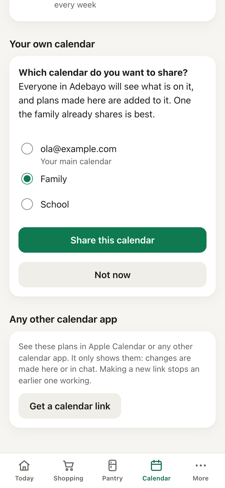
  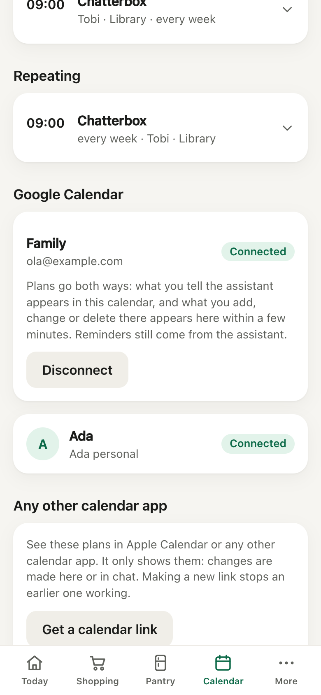

A trip that connects nothing lands on the same page with a sentence saying why: permission was
not given, a box was unticked, the account has no calendar that can be added to, Google could not
be reached, or the answer came back more than ten minutes later or to someone else.

| The card shows | When |
| --- | --- |
| "Connect Google Calendar", and "Connect Apple Calendar" ([below](#a-connected-apple-calendar)) | Nothing is connected |
| The calendars to pick from, and "Not now" | Signed in, none picked |
| The calendar's name and address, "Connected", and "Disconnect" | Working. If Google is not answering it says so, and that it will be tried again |
| "Your Google Calendar has stopped being kept in step", with "Connect again" | The sign-in no longer works. The person was also told in chat |
| "Google Calendar is not switched on for this household yet", under the Apple form | The installation has the key and no Google client ([operations.md](operations.md#google-calendar)) |
| "Connecting a Google or Apple calendar is not switched on for this household yet" | The installation has no key |

Below the card, each other adult who has connected one is listed with its name. An adult can
only disconnect their own. **Disconnect** deletes the stored sign-in and tells Google it is
finished with; every event stays where it is on both sides. One calendar can be shared with a
household once: a second adult who picks the same one is told who already shares it.

What then happens to events, and what does not, is in
[data-model.md](data-model.md#connected-calendars). A change that came from a calendar is on the
Activity page under the owner's name, "in their own calendar", with an Undo button; undoing it
removes it from the calendar as well. Connecting and disconnecting are logged there too, with
nothing to undo.

## A connected Apple Calendar

The same card connects an Apple (iCloud) calendar
([ADR 0041](adr/0041-apple-calendar-is-caldav-with-an-app-specific-password.md)). Apple has no
page to say yes on, so the person makes a password for this at Apple and types it here:

1. **Connect Apple Calendar** opens a short form. Above it are Apple's two steps, in Apple's own
   words: open account.apple.com (a link) and choose App-Specific Passwords under Sign-In and
   Security; then Generate an app-specific password, name it, and copy what Apple shows. The
   form says that the password they sign in to Apple with is never typed here.
2. They type the email they sign in to Apple with and the app-specific password, and the form is
   posted to `/dashboard/calendar/connect/apple`. The pair is tried against iCloud at once. If
   Apple accepts it, it is stored encrypted and the card asks **which calendar to share**, as
   for Google; if not, the page says so and keeps nothing. The password is never shown back.
3. From there it is the same: "Bringing your plans over", then Connected.

  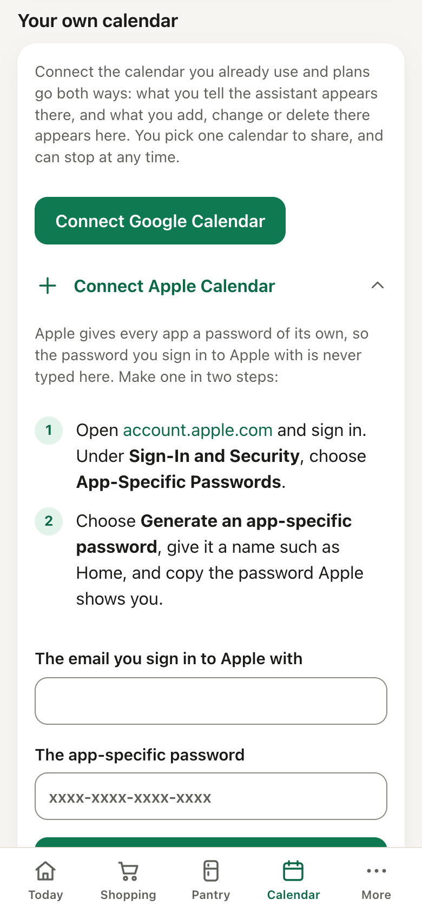
  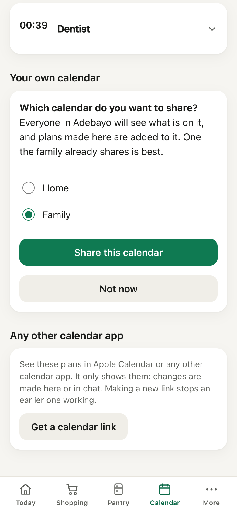
  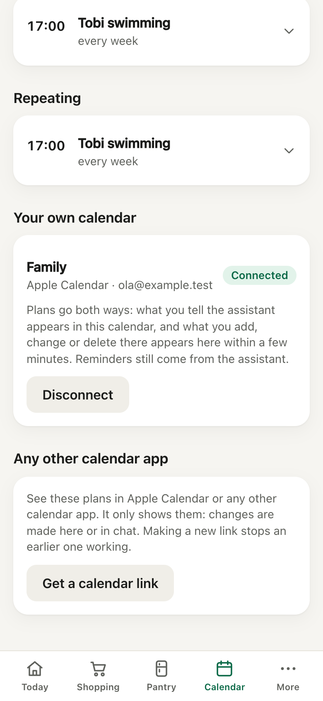

| The page says | When |
| --- | --- |
| "Apple did not accept that email and password. It has to be an app-specific password…" | Apple answered that the sign-in is wrong. It was asked once |
| "That Apple account has no calendar that plans can be added to." | The account has only calendars that can be looked at, or reminders |
| "Apple could not be reached just now. Try again in a minute." | A fault, a timeout or a rate limit at Apple |
| "Disconnect the calendar you have connected first." | The person already has a working connection |
| "Your Apple Calendar has stopped being kept in step", with the form again and "Connect again" | The password was removed at Apple, or the person changed their Apple password, which cancels every such password. They were also told in chat |
| "Apple Calendar is disconnected. The password you made for it still works at Apple until you remove it…" | After **Disconnect**: Apple cannot be told, so the person is told where to remove it |

A calendar that holds only reminders, and one that someone else lets them look at but not
change, are not offered. An event with guests comes in as a plan, but a change made here to it
is not sent: iCloud would email the guests.

## Calendar feed

"Get a calendar link" on the Calendar page, under "Any other calendar app", creates a link of the
form `/ics/{token}.ics` for Apple Calendar or any other app. The token is 32 random bytes and only its SHA-256 is stored, so the link is
shown once; making a new one stops the old one working. The feed is read-only: one `VEVENT` per
active event, `DTSTART` with the household `TZID` (or a plain date for an all-day event), the `RRULE`
and exception dates passed through,
`UID` `{event_id}@household-agent`, and a 15-minute `Cache-Control`. It carries no `VTIMEZONE`
block ([ADR 0015](adr/0015-ics-feed-token-and-time-zones.md)).

## How writes work

Pages never write SQL. A write calls the same `app/services/` function the agent tool uses, inside
`record(...)` with `source = 'dashboard'`, so stock rules, undo and the Activity log behave exactly
as they do from chat. Ticking an item's circle in the browser logs a restock, just as "got the
eggs" does. Brief time, quiet hours, the currency, facts, added members, the preferred channel and a
corrected or removed receipt can be undone from Activity. Creating or revoking an invite, creating a group and choosing the main family chat
are logged but not undoable, and a member who has connected can no longer be removed by undo.

Practice chat calls `simulate_turn()`, the same service the eval suite uses. A practice run executes
the whole turn in a transaction and rolls it back, so nothing is saved and each practice message
starts without memory of the last one.

Merging duplicates reassigns events, stock, list entries and aliases to the kept item in one
transaction and cannot be undone.
